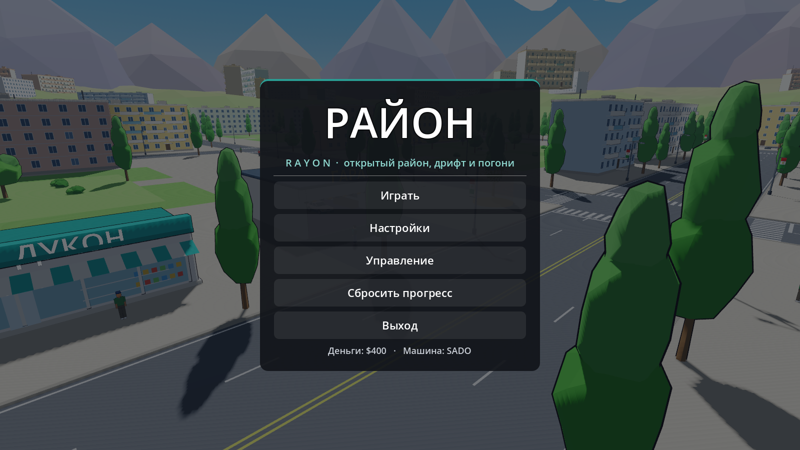
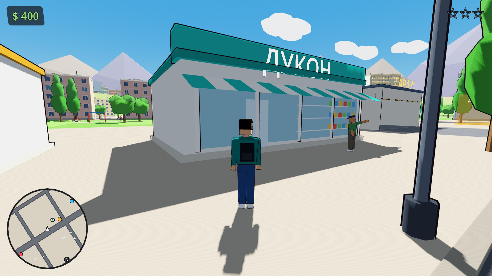
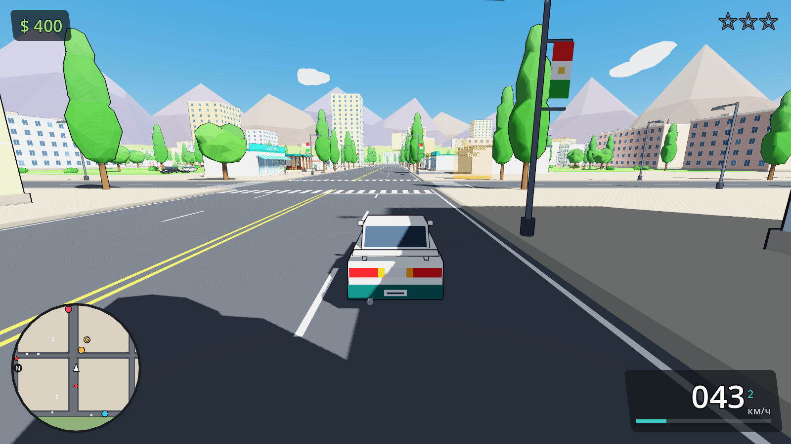
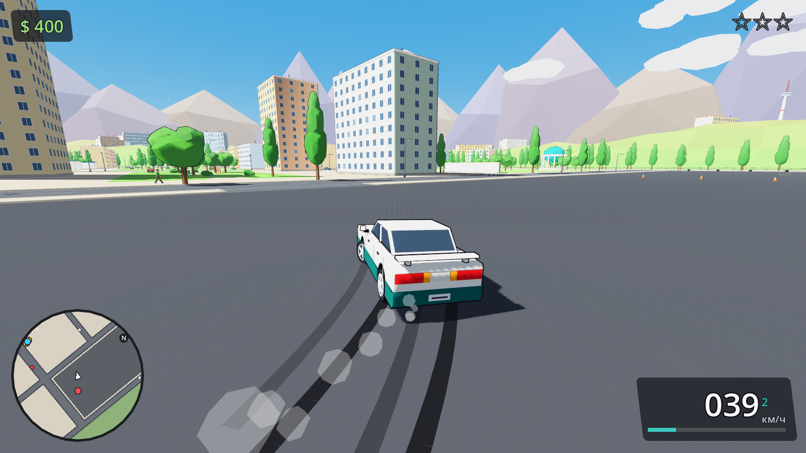
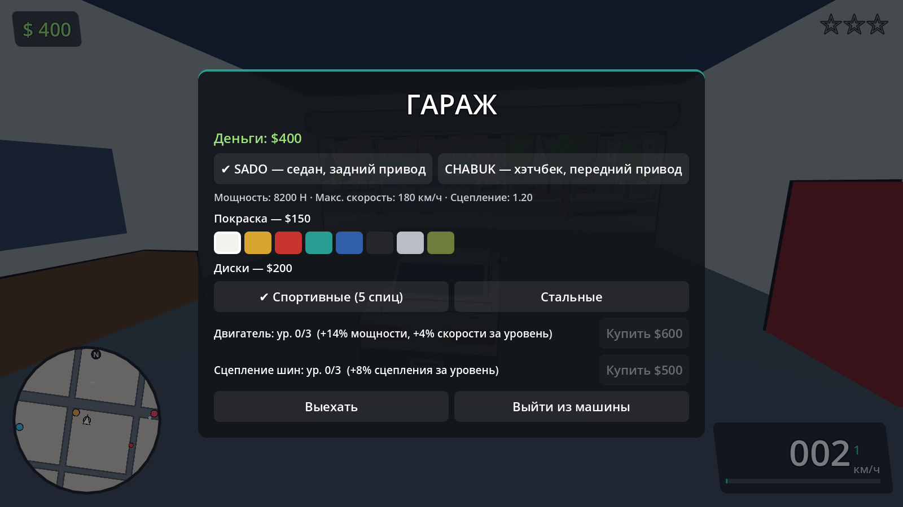

# РАЙОН / RAYON

Аркадная 3D-игра на **Godot 4.3** (GDScript): небольшой открытый район с атмосферой Душанбе,
передвижение пешком, вождение и дрифт, трафик и пешеходы, три задания, полицейские погони и гараж
с улучшениями. Мультяшная low-poly графика с плоскими цветами и тёмными контурами.

Все 3D-модели (машины, герой, жители, здания, деревья, фонари, остановка, гараж, телебашня и т. д.)
созданы кодом в этом проекте, без скачанных ассетов, и сохранены в папку [`models/`](models/)
в виде сцен Godot (`.tscn`) и универсальных файлов `.glb` (открываются в Blender и других редакторах).



| | |
|---|---|
|  |  |
|  |  |

## Запуск

1. Установите **Godot 4.3** (или новее из ветки 4.x, стандартная версия, не .NET): https://godotengine.org/download
2. Запустите Godot → **Импорт** → выберите файл `rayon/project.godot` → **Импортировать и редактировать**.
3. Нажмите **F5** (▶ «Запустить проект»).

Запуск без редактора из терминала:

```bash
godot --path rayon
```

Сборка исполняемого файла: в редакторе **Проект → Экспорт…**, добавьте пресет Windows/Linux,
при необходимости скачайте шаблоны экспорта (кнопка в том же окне) и нажмите «Экспортировать проект».

Проект использует рендерер **Compatibility (OpenGL 3)**: он работает почти на любом компьютере.

## Управление

| Клавиша | Действие |
|---|---|
| W A S D | движение пешком / газ, тормоз-задний ход, руль |
| Мышь | обзор (клик по окну захватывает мышь) |
| Shift | бег |
| Пробел | ручной тормоз (дрифт) |
| E | сесть / выйти / начать задание / открыть гараж |
| R | поставить перевёрнутую или застрявшую машину на дорогу |
| Enter | повторить задание после победы или провала |
| H | сигнал (пешеходы разбегаются) |
| Esc | пауза |
| F3 | счётчик FPS |

## Игровой цикл

Старт у гаража → садитесь в свою машину (E) → задания отмечены цветными кольцами на мини-карте →
награда → заезжайте в гараж (жёлтая **G** на карте, у проспекта) на своей машине и нажмите **E** →
перекраска, диски, улучшения двигателя и сцепления.

* **Доставка** (оранжевый маркер у гаража, $600): сядьте в фиолетовый CHABUK клиента и довезите его до адреса за 62 с.
* **Кольцо** (голубой маркер на западной окружной, $800): 16 контрольных точек по окружной дороге быстрее 112 с.
* **Оторвись** (красный маркер на дрифт-площадке, $1000): получите 2 звезды розыска и скройтесь от полиции.

Полиция: таран патрульной машины, угон на глазах у полиции, наезд на пешехода или скорость выше 95 км/ч рядом
с патрулём дают розыск (до 3 звёзд). «Погоня» — вас видят; «Поиск» — патрули едут к последней известной точке;
после достаточного времени вне поля зрения — «Вы скрылись». Хорошее укрытие — крытая стоянка во дворе на юге
района. Если остановиться рядом с полицией на 3 секунды — задержание, штраф и возврат к гаражу.

## Структура

```
rayon/
  project.godot          настройки, автозагрузки Game и Sfx
  scenes/main.tscn       главная сцена
  models/                готовые модели: cars/, people/, buildings/, props/ (.tscn + .glb)
  shaders/outline.gdshader  контуры (inverted hull)
  scripts/
    models/              генераторы моделей (MeshKit, CarBuilder, PersonBuilder, PropBuilder)
    world/               план района (CityLayout), сборка города, освещение
    vehicles/car.gd      физика машины (лучевые колёса, круг трения, занос), следы и дым
    actors/              герой, анимации людей, пешеходы
    ai/                  ИИ водителей, трафик, полиция
    game/missions.gd     три задания
    ui/                  HUD, мини-карта, меню и гараж
    autoload/            сохранение/настройки (game.gd), процедурный звук (sfx.gd)
    tools/               build_models.gd (пересобрать models/), preview.gd (рендер превью)
  tests/                 автотесты: drive_test.gd, game_test.tscn
```

Пересобрать модели после изменения генераторов:

```bash
godot --headless --path rayon -s res://scripts/tools/build_models.gd
```

Автотест всего игрового цикла (посадка/выход, вождение, дрифт, восстановление, столкновения, погоня,
задержание, три задания, гараж, сохранение):

```bash
godot --headless --path rayon res://tests/game_test.tscn
```

Сохранение: `user://rayon_save.json` (Windows: `%APPDATA%\Godot\app_userdata\РАЙОН _ RAYON\`).
Повреждённый файл не ломает игру: он копируется в `.bak`, игра начинается заново. Кнопка
«Сбросить прогресс» — в главном меню.

## Проверка

Автотест `tests/game_test.tscn` запускает настоящую игровую сцену и проверяет 46 пунктов — все проходят:
ходьба и бег; 5 циклов посадки/выхода подряд; разгон (≈74 км/ч за 3,5 с), торможение, задний ход;
дрифт на ручнике (угол заноса ≈28°) и следы шин; переворот и восстановление на R (машина ставится на полосу);
столкновение со стеной гаража; трафик и пешеходы; начало погони, появление патрулей вне обзора (≥90 м),
переход в «Поиск» и «Вы скрылись»; задержание со штрафом и возвратом к гаражу; все три задания (победа,
провал по времени, повтор, награда ровно один раз); покупки в гараже реально меняют мощность/сцепление/цвет/диски;
смена машины; сохранение, повреждённый и некорректный файл сохранения, сброс прогресса; режим низкого качества.
`tests/drive_test.gd` сравнивает поведение трёх машин (SADO уходит в занос ≈35°, CHABUK держится ≈4°, POSBON
тяжелее и быстрее). Экспорт `.pck` (пресеты в `export_presets.cfg`) собран и запущен отдельно от исходников.

Производительность: на тестовой машине без видеокарты (программный рендер) расход процессора — около
3,3 мс на кадр скриптов и 4,2 мс на шаг физики (23 машины, 58 пешеходов). FPS на реальной видеокарте при 1080p
здесь измерить нельзя; включите счётчик F3 и при необходимости «Низкое» качество (без теней и контуров,
пониженное разрешение 3D, меньше трафика и пешеходов).

## Что реализовано

* Район ~600 × 600 м: широкий проспект, сетка улиц и Т-перекрёстки, разметка и зебры, тротуары с бордюрами,
  дворы с газонами, деревьями, качелями и скамейками, магазины («ДУКОН», «НОН», «ДОРУХОНА», чайхана, киоск),
  гараж, парк с фонтаном и ротондой, дрифт-площадка, крытая стоянка (укрытие), окружная дорога для «Кольца»,
  забор и холмы по краю карты, горы, облака, телебашня и дальние кварталы на горизонте. Коллизии у зданий,
  деревьев, фонарей, остановки, машин.
* Герой: ходьба, бег, анимации; посадка/выход с проверкой свободного места (6 вариантов вокруг машины);
  угон машины у водителя (водитель выбегает) и патрульной машины.
* Камера от третьего лица, в машине — следование сзади с отдалением на скорости и обзором мышью,
  не проходит сквозь стены (SpringArm).
* Физика: лучевая подвеска, круг трения шин, привод RWD/FWD, зависимость руля от скорости, ручник,
  стабилизатор заноса, крены, сопротивление воздуха, восстановление; следы шин и дым.
* Трафик (SADO/CHABUK разных цветов) по полосам с торможением перед препятствиями; пешеходы с занятиями
  (прогулка, телефон, разговор, скамейка, остановка, дворник), уворачиваются и падают при наезде.
* Полиция: 0–3 звезды, свидетели с проверкой прямой видимости, погоня по графу улиц с перехватом,
  поиск, «Вы скрылись», задержание, мигалки и сирена.
* Три задания, гараж (2 машины, 8 цветов, 2 вида дисков, 3 уровня двигателя и сцепления), HUD с мини-картой,
  меню/пауза/настройки (громкость, качество, чувствительность, инверсия Y), процедурный звук,
  сохранение с защитой от повреждений.

## Ограничения (честно)

* Реальный FPS на видеокарте не измерен — только нагрузка на процессор (см. выше).
* Игра проверена автотестами и скриншотами; живого ручного прохождения с клавиатурой и мышью не было,
  поэтому тонкую настройку руля/камеры «на ощупь» стоит сделать при игре.
* ИИ трафика упрощённый: нет светофоров и очередности на перекрёстках, машины иногда сталкиваются между собой;
  застрявшие и перевёрнутые машины вне камеры убираются.
* Пешеходы не имеют физических тел (проверка наезда по габаритам машины), не переходят дорогу.
* Повреждений машин нет; «Кольцо» проверено телепортом по точкам, время 112 с подобрано расчётом.
* Звук синтезируется в коде — простой, без записанных сэмплов.
* Экспорт в .exe требует шаблонов экспорта Godot (скачиваются в редакторе); здесь проверен `.pck`.
